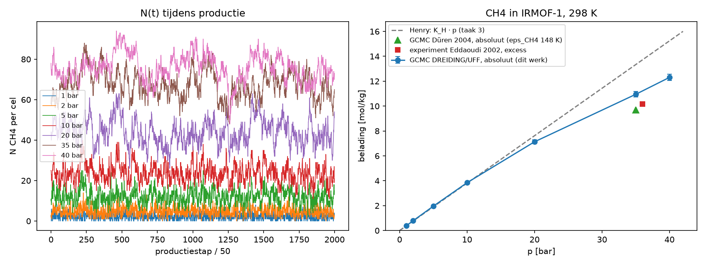
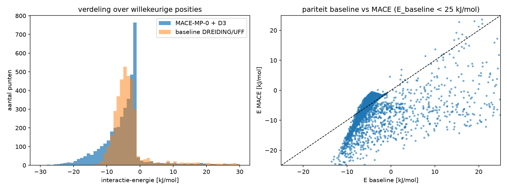
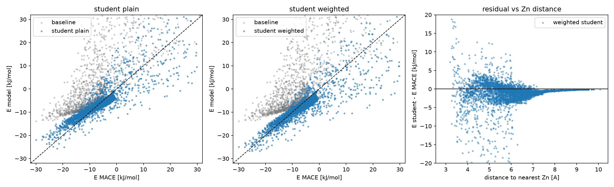

# MLFF distillation for GCMC, in miniature: CH4 in IRMOF-1

A two-week lab notebook on one question: **can a machine-learned force field (MLFF) be distilled into something
cheap enough to sit in the inner loop of a Monte Carlo adsorption simulation, without losing what made it better?**

The system is deliberately small: united-atom methane in rigid IRMOF-1 (MOF-5), no charges, no Ewald.
Everything after the MACE dataset runs on a laptop in minutes.

## Why

Grand-canonical Monte Carlo (GCMC) is how adsorption isotherms are computed for porous materials. It needs
10^5 to 10^6 energy evaluations per pressure point. A generic force field (DREIDING/UFF, Lennard-Jones only)
does one evaluation in ~40 µs. An MLFF like MACE-MP-0 does one in ~0.2 s on a GPU: 5000× slower, so one
isotherm would take days instead of seconds. But the generic force field is wrong in known ways.

Distillation: use the MLFF as a **teacher** to label a few thousand configurations once, fit a cheap
**student** with the same functional form as the generic force field, and run GCMC with the student.
This repo does exactly that and measures where it works and where it breaks.

## System and force fields

| | |
|---|---|
| Framework | IRMOF-1 (MOF-5), cubic cell 25.832 Å, 424 atoms (Zn 32, O 104, C 192, H 96), rigid |
| Guest | CH4, one LJ site: ε = 158.5 K, σ = 3.72 Å (Martin et al. 2001 parameters as used by Dubbeldam et al. 2007; *not* the 148 K TraPPE value) |
| Baseline | DREIDING (C, H, O) + UFF (Zn), Lorentz-Berthelot mixing, cutoff 12 Å, shifted potential, no tail correction |
| Teacher | MACE-MP-0 medium + D3 dispersion, float64, via ASE, on a V100 (UGent HPC) |
| Student | same shifted-LJ sum as the baseline, but the 8 CH4-framework pair parameters (ε, σ for Zn, O, C, H) are free and fitted to the teacher |
| Units | energies in K (E / k_B), so βU = U/T |

Pair parameters (ε [K] / σ [Å]) with CH4:

| pair | baseline (Lorentz-Berthelot) | student, Boltzmann-weighted fit |
|---|---|---|
| CH4–Zn | 99.5 / 3.09 | 108.9 / 3.92 |
| CH4–O | 87.4 / 3.38 | 451.0 / 2.93 |
| CH4–C | 87.1 / 3.60 | 96.5 / 3.44 |
| CH4–H | 34.8 / 3.28 | 0.1 / 4.24 (ε at the lower bound: H switched off) |

## Method

1. **Energy function** (`src/energy.py`). Minimum-image distances from one point to all 424 atoms, vectorised;
   LJ per pair with the shift applied to every pair inside the cutoff. Checked against a pure-Python loop.
   Cell origin: −117.95 K; minimum over 10^4 random points ≈ −13.8 kJ/mol near the Zn4O corners.
2. **Widom insertion** (`src/widom.py`). K_H = ⟨exp(−U/T)⟩ / (ρ_fw R T) in mol/kg/Pa, 10^5 insertions,
   standard error from 10 block averages.
3. **GCMC** (`src/gcmc.py`). Translate / insert / delete with equal probability, local ΔU (only the moved
   molecule's framework term and its CH4–CH4 pairs), fugacity from Peng-Robinson, 20k equilibration + 100k
   production steps, 10 block averages. Two checks: (a) the sum of accepted ΔU equals an independent slow
   `total_energy` to 1e-11 K; (b) at 1 bar ⟨N⟩ agrees with K_H·p from Widom to 2%.
4. **MACE dataset** (`src/mace_dataset.py`, `hpc/make_dataset.py`). 4000 uniformly random positions in the
   empty cell; positions where the baseline says overlap (> 10 000 K, 44% of draws) are skipped. All-atom CH4
   with a uniformly random orientation (quaternion) and the carbon exactly on the point.
   E_int = E(framework + CH4) − E(framework) − E(CH4 alone). 0.19 s per point on a V100.
   The CSV is committed, so steps 5–6 need no GPU.
5. **Student fit** (`src/fit.py`). `scipy.optimize.least_squares` on the 8 pair parameters, bounds
   ε ∈ [0.1, 500] K, σ ∈ [2, 5] Å, started from the baseline. Two variants: plain least squares on E, and
   Boltzmann-weighted with w = exp(−E_MACE / 1000 K).
6. **Throughput** (`notebooks/08_throughput.ipynb`). Same 4000 points through each model.

## Results

### Baseline isotherm (sanity check of the GCMC code)



CH4 in IRMOF-1 at 298 K, absolute loading. At 35 bar: 10.95 ± 0.21 mol/kg here vs 9.70 mol/kg simulated by
Düren et al. (Langmuir 2004, DREIDING, ε_CH4 = 148 K) and ≈ 10.2 mol/kg excess measured by Eddaoudi et al.
(Science 2002). The 13% excess over Düren is mostly the 7% deeper CH4 well (158.5 vs 148 K), which enters
exponentially. Translation acceptance 31–48%, insertion and deletion equal.

### What the teacher says that the baseline does not



Where both are attractive (3291 of 4000 points) the median difference is 0.1 kJ/mol: the generic force field is
fine in the middle of the pores. It is wrong in two places. MACE has wells down to −30 kJ/mol near the linkers
that the baseline (min −14 kJ/mol) does not have, and the baseline's repulsive wall starts too far out: where
LJ says 6000–10 000 K, MACE is still at −10 kJ/mol. The 71 points below −20 kJ/mol carry 78% of ⟨exp(−E/T)⟩.

### Student vs teacher



| model | ⟨exp(−E/T)⟩ on the dataset | RMS all points | RMS attractive | RMS deep (< −20 kJ/mol) |
|---|---|---|---|---|
| baseline | 10 | 1510 K | 462 K | 1539 K |
| student, plain least squares | 118 | 479 K | 218 K | 531 K |
| student, Boltzmann-weighted | 311 | 624 K | 216 K | 289 K |
| MACE | 379 | | | |

The plain fit is "better" on average and worse where it matters: 77% of its cost comes from 325 repulsive
points that GCMC never visits. The weighted fit trades accuracy on the wall for accuracy in the wells.

### Henry coefficients at 298 K (main result)

| model | K_H [mol/kg/Pa] | vs baseline | vs MACE | how |
|---|---|---|---|---|
| baseline DREIDING/UFF | 3.83e-6 ± 0.02e-6 | 1 | 0.03 | Widom, 10^5 insertions |
| student, plain fit | 3.59e-5 ± 0.10e-5 | 9 | 0.25 | Widom, 10^5 insertions |
| student, weighted fit | 9.09e-5 ± 0.23e-5 | 24 | 0.63 | Widom, 10^5 insertions |
| MACE-MP-0 + D3 | 1.44e-4 ± 0.2e-4 | 38 | 1 | Widom on the 4000 dataset points |

### Throughput

| model | hardware | s / evaluation | evaluations / s | vs MACE |
|---|---|---|---|---|
| baseline, `energy_fast` | CPU (Apple M-series), 1 LJ site | 3.8e-5 | 26 000 | 5000× |
| student, `energy_fast` | CPU (Apple M-series), 1 LJ site | 3.7e-5 | 27 000 | 5000× |
| MACE-MP-0 medium + D3 | GPU (V100), 429 atoms | 0.19 | 5 | 1× |

The student costs exactly what the baseline costs. One GCMC pressure point (≈ 1.2·10^5 evaluations) is seconds
with the student and 6–12 GPU-hours with MACE.

## Where the student fails

- **Hydrogen is switched off.** Both fits drive ε_H to the lower bound and compensate with an O well four times
  deeper and smaller. The student has effectively six parameters; ε and σ of one pair are strongly correlated.
- **Overfitting to the deep wells.** On the dataset it was fitted on, student/MACE is 0.82; on fresh Widom
  insertions it is 0.63. The weighting lets 71 points dominate, and 8 parameters partly adapt to those points.
- **Near the Zn4O corners.** Beyond 7 Å from a Zn the student is exact; within 3–6 Å the residual spreads to
  ±20 kJ/mol in both directions (right panel of the parity figure). One LJ sphere per pair cannot follow the
  shape, nor the orientation dependence, of the MACE well there: the teacher sees all-atom CH4, the student
  only the carbon.

## Limitations

- United-atom student vs all-atom teacher; rigid framework; no electrostatics (fine for CH4, not for CO2).
- MACE-MP-0 + D3 is not a perfect reference. Its deepest wells (−30 kJ/mol) and K_H (38× the generic value)
  are probably too strong against experiment (Q_st ≈ 12 kJ/mol). The question here is whether the student
  reproduces the teacher, not whether the teacher is right.
- Cutoff 12 Å with shift, no tail correction; 10^5 production steps give a 2% error bar at 40 bar.
- One dataset, one seed, no held-out test set beyond the fresh Widom run.

## Next steps

- Isotherm with the student via GCMC (same code, student parameter arrays; the cost is the same as the baseline).
- Active learning: sample the deep-well regions and the large-residual regions, label with MACE, refit.
- A small MLP (positions → energy) as a second student, to see whether the LJ form is the bottleneck.
- Grid pre-tabulation of the framework energy with trilinear interpolation (Frenkel & Smit appendix I), another
  10–100× in throughput.
- CO2 with Ewald; Dubbeldam 2007 as a second, MOF-specific baseline.

## Reproduce

```bash
python -m venv .venv && source .venv/bin/activate && pip install -r requirements.txt
cd notebooks
jupyter nbconvert --to notebook --execute --inplace 03_widom.ipynb          # K_H baseline, ~10 s
jupyter nbconvert --to notebook --execute --inplace 04_gcmc_uff.ipynb       # isotherm, ~2 min
jupyter nbconvert --to notebook --execute --inplace 06_mace_dataset.ipynb   # dataset analysis, needs only the CSV
jupyter nbconvert --to notebook --execute --inplace 07_student.ipynb        # fits + K_H table, ~3 min
jupyter nbconvert --to notebook --execute --inplace 08_throughput.ipynb
```

Regenerating the MACE dataset needs a GPU with `mace-torch` and `torch-dftd`; see `hpc/` for the Slurm
wrappers used on the UGent HPC (`run_gpu_joltik.sh`) and run

```bash
python hpc/make_dataset.py --n 4000 --seed 6 --out data/mace_dataset_irmof1_ch4.csv
```

`python hpc/make_dataset.py --calc lj --n 20` runs the same pipeline with a dummy calculator for a local test.

Notebooks 01, 02 and 05 are development scratchpads (absolute paths, superseded by `src/`); they are kept for the
record but are not part of the pipeline above.

## Layout

```
src/energy.py        framework loading, LJ pair parameters, minimum image, energy_fast
src/widom.py         Widom insertion, Henry coefficient
src/gcmc.py          GCMC moves and loop, block averages, slow total_energy, Peng-Robinson fugacity
src/mace_dataset.py  all-atom CH4 placement, interaction energy with any ASE calculator
src/fit.py           student parametrisation, residuals, weighted least squares
hpc/                 MACE test and dataset scripts + Slurm wrappers
data/                IRMOF-1.cif, force-field files, the committed MACE dataset (4000 points)
results/             isotherm, dataset overview, parity plots, fitted parameters
notebooks/           01 structure · 02 energy · 03 Widom · 04 GCMC · 05/06 MACE · 07 student · 08 throughput
```

References: Frenkel & Smit, *Understanding Molecular Simulation* 3rd ed. (§3.2, §6.5, §8.5); Düren, Sarkisov,
Yaghi, Snurr, Langmuir 2004, 20, 2683; Eddaoudi et al., Science 2002, 295, 469; Batatia et al., MACE-MP-0
(arXiv:2401.00096); Dubbeldam et al., Angew. Chem. 2007 (force-field parameters).
